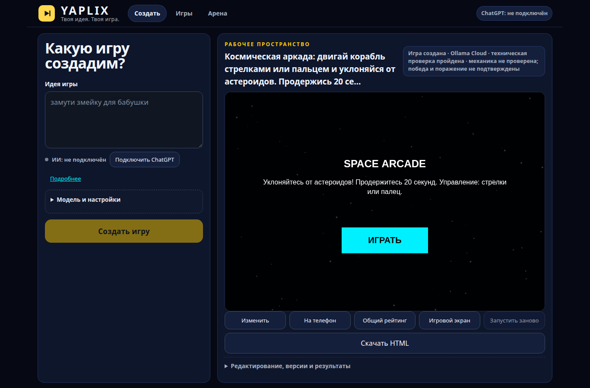
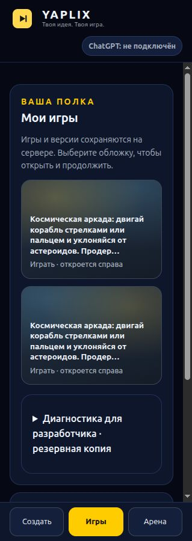

# YAPLIX — ты придумал, теперь играй

Создавайте браузерные игры обычным текстом. YAPLIX получает полный HTML от модели,
проверяет его в защищённом браузере, исправляет подтверждённые ошибки и сохраняет
версии. Готовую игру можно изменить новым запросом и скачать одним HTML-файлом.

**Три раздела: Создать · Игры · Арена.** Сервер хранит игры и обращается к модели;
играть можно в браузере компьютера или телефона. Предустановленных DEMO нет.



[Быстрый запуск](#быстрый-запуск) · [Путь проверяющего](#создать-изменить-и-экспортировать) ·
[Презентация](docs/presentation.html) · [Слайды Markdown](docs/presentation.md) ·
[Сценарий выступления](docs/defense-runbook-2026.md) · [Точный статус](docs/submission-status.md)

## Кандидат сдачи — 29 октября 2026

Основа — локальная версия RELEASE-007F и последующие исправления, сохранённые
отдельным снимком; интеграция опубликована в [Draft PR #69](https://github.com/Sashido01/YAPLIX/pull/69).
Пока PR не слит, для проверки используйте **ветку `codex/submission-009`**, а не старый `main`.

Реальный путь Ollama Cloud **create → automatic repair → Library → edit → версия →
restart → export/offline** подтверждён на отдельной SQLite. Полный локальный
регрессионный прогон выполняется; Draft не объявлен готовым релизом. Качество
произвольного ответа модели и физические Android/iOS/Windows этим не гарантируются.
Подробности и оставшиеся ограничения: [статус сдачи](docs/submission-status.md).

## Быстрый запуск

### Из репозитория — Ubuntu 24.04 x64

В новой папке, не поверх вашей рабочей копии:

```sh
git clone --branch codex/submission-009 https://github.com/Sashido01/YAPLIX.git
cd YAPLIX
sh install.sh
```

Установщик проверяет компоненты, собирает приложение и устанавливает его в личный
профиль. При первом запуске нужна сеть для недостающих компонентов. Системные
пакеты и существующие программы не меняются. Данные остаются отдельно от программы.
Доступ к приватному репозиторию должен быть выдан владельцем.

### Готовый установщик

Если организатор передал Ubuntu Lite `.run`, разрешите выполнение этого файла и
запустите его. Нужен установленный Google Chrome, проходящий защищённую проверку.
Пакет ставится без `sudo`, открывает YAPLIX и создаёт пункты меню. Для повторного
запуска выберите **YAPLIX** в меню приложений.

Готовые установщики не входят в Git. Lite проверен на текущей Ubuntu; независимая
машина и Windows пока не приняты. В Windows предусмотрен `YAPLIX.cmd`, но его
наличие не заменяет проверки на Windows. [Подробная инструкция](INSTALL.md).

### Для разработчика с Node.js 24.18+ (24.x)

```sh
npm ci
npm run checker:install
```

Создайте `.env` в корне проекта со своим серверным ключом:

```dotenv
LIVE_PROVIDER=ollama-cloud
OLLAMA_CLOUD_API_KEY=your-own-key
```

```sh
npm run app
```

Откройте адрес, напечатанный launcher. Не передавайте `.env`, ключи или свою SQLite
в репозиторий. Не отключайте sandbox, если проверка браузера не запускается.
[Подготовка Ubuntu](docs/UBUNTU_SETUP.md) · [Команды разработки](docs/development-setup.md).

## Подключить модель

В установленной программе откройте пункт меню **Настроить AI YAPLIX**, выберите
**Ollama Cloud** и введите собственный API-ключ, затем перезапустите YAPLIX.
В запуске из исходников используйте `.env`, как показано выше.

В приложении раскройте **«Модель и настройки»** и выберите
**Ollama Cloud · gemma4:31b**. Ключ хранится на сервере и не передаётся игровому HTML.
Для генерации требуется подключение к провайдеру; без ключа можно открывать свои
ранее сохранённые игры. Встроенной бесплатной подмены генерации нет.

OpenRouter Free доступен как ручной вариант. ChatGPT — отдельное экспериментальное
локальное подключение с ограничениями: [инструкция](docs/chatgpt-setup.md).
Автоматического переключения между провайдерами нет. Надпись «ChatGPT: не подключён»
показывает только состояние личного ChatGPT; для Ollama Cloud выберите его в настройках.

## Создать, изменить и экспортировать

1. **Создать.** Выберите модель, опишите короткую игру и нажмите **«Создать игру»**.
   Например: «Космическая аркада: двигай корабль стрелками или пальцем и уклоняйся
   от астероидов. Продержись 20 секунд для завершения раунда; столкновение завершает игру».
2. **Дождаться результата.** Видны этап, время и отмена. При подтверждённом исправимом
   дефекте выполняется ограниченное исправление той же моделью. Ответ может быть
   отклонён; причину покажет приложение. Не обещаем генерацию за фиксированное время.
3. **Играть.** Откройте готовую версию из уведомления или раздела **«Игры»**,
   нажмите Start внутри игры и попробуйте управление. Надпись «техническая проверка
   пройдена» не означает полной проверки игровой механики.
4. **Изменить.** Нажмите **«Изменить»**, введите, например, «Сделай корабль ярко-зелёным,
   сохрани правила и управление» и создайте следующую версию. Предыдущая остаётся
   в истории версий. Возврат «К игре» в редакторе — контекстное действие.
5. **Экспортировать.** Нажмите **«Скачать HTML»**. Откройте скачанный файл в браузере:
   сама игра не требует сервера YAPLIX. Для нового создания или изменения снова
   нужны сервер и подключённая модель.
6. **Вернуться позже.** Перезапустите YAPLIX и откройте игру в **«Игры»**.
   Игры и версии сохраняются в SQLite; обновление программы не должно удалять данные.



**Арена** — дополнительный сценарий общего рейтинга для совместимых игр.
Для первого знакомства достаточно создания, игры, редактирования и экспорта.
[Арена и QR](docs/arena.md) · [Безопасное подключение телефона](docs/phone.md).

## Презентация и документация

- Откройте [presentation.html](docs/presentation.html) локально в браузере: восемь
  слайдов, кнопки и стрелки клавиатуры, внешние ресурсы не нужны. GitHub показывает
  исходник HTML — для показа используйте локальный файл.
- [Markdown-слайды](docs/presentation.md) и [выступление на 3–5 минут](docs/defense-runbook-2026.md).
- [Установка и данные](INSTALL.md), [архитектура](docs/architecture.md),
  [диагностика](docs/diagnostics.md), [известные ошибки](docs/known-errors.md).
- [Все руководства](docs/README.md), [результаты приёмки](docs/submission-status.md).

Дизайн выборочно адаптирован из PR #66 участника **jeanhayl**; материалы презентации —
из PR #67. [Авторы](AUTHORS.md) · [Границы интеграции дизайна](docs/pr-66-review-and-integration.md).

## Проверки для разработчика

```sh
npm run check:quick
npm run check:integration
npm run check:full
```

Полный режим включает typecheck, build, unit/browser, проверки репозитория и
secret scan; для последнего нужен Gitleaks. Реальные LLM-вызовы — отдельная,
явно разрешённая проверка. Hosted Actions временно отключены владельцем и не
считаются прошедшими. Физические устройства проверяются отдельно от эмуляции.
