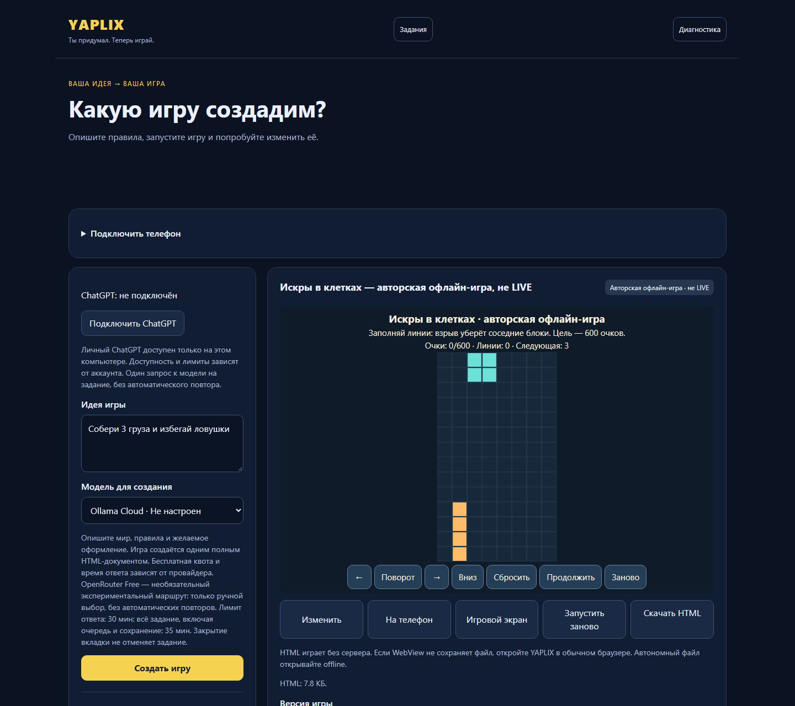
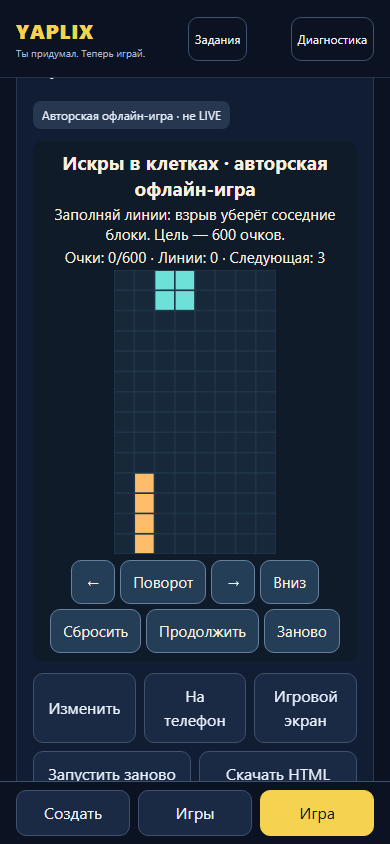

# YAPLIX — ты придумал, теперь играй

YAPLIX превращает текстовую идею в самостоятельную HTML5-игру: генерирует полный HTML, проверяет его, сохраняет версии и запускает игру в изолированном окне. Проект создан для кейса Билайна на «ИТ-спринт 2026»: сократить путь от идеи до игры, которой можно поделиться и в которую можно соревноваться.





Снимки сделаны из работающего приложения с авторской офлайн-игрой, без генерации изображения или подмены счёта. Мобильный вид — браузерная эмуляция. [Происхождение снимков](docs/media/README.md).

## Возможности

- **Без ключей:** три авторские игры в библиотеке: [Arena: Меткий бросок](assets/games/arena-target.html), [Искры в клетках](assets/games/ember-blocks.html), [Световой лабиринт](assets/games/prism-maze.html). Их можно открыть и сохранить в локальную SQLite.
- **С поддерживаемым LLM:** создание и изменение полного HTML по запросу. Задания сохраняют состояние и черновик; проверка Canvas/WebGL, CSP и браузерного поведения предшествует сохранению новой версии. Старые версии остаются доступными.
- **Arena:** один QR для комнаты, независимые партии и общий рейтинг с сохранением после перезапуска. Метрика версии — очки, время прохождения, дистанция или выживание. Для известных авторских игр подготовка локальная; для неизвестной старой игры нужна заданная цель и отдельное согласие на LLM. [Как работает Arena](docs/arena.md).
- **Экспорт и восстановление:** автономный HTML, история версий, диагностика и проверяемые резервные копии SQLite.

## Запуск из чистого клона

Нужны Git, Node.js **24.18+ из ветки 24.x** и npm. Для приватного репозитория нужен доступ GitHub. После публикации этого кандидата в `main`:

```sh
git clone https://github.com/Sashido01/YAPLIX.git
cd YAPLIX
npm ci
npm run app
```

Launcher соберёт клиент и выведет локальный URL, обычно `http://127.0.0.1:3000/`. Откройте **Игры → Авторские аркады**. Ключ, `.env` и браузер Playwright для просмотра готовых игр не нужны. Данные хранятся локально в SQLite; для тестового запуска используйте отдельный `YAPLIX_DATA_HOME` или `YAPLIX_DB`. [Общая настройка, backup и команды](docs/development-setup.md).

Исходники переносимого установщика включены, готовые бинарные пакеты в Git не хранятся. Для Ubuntu 24.04 x64 есть локально проверенный Lite-вариант с установленным Google Chrome и Full-вариант со своим Chromium; сборка требует отдельно полученных официального Node-архива и браузерных файлов. [Установка](INSTALL.md) · [Сборка пакета](docs/installer-building.md). Графический двойной щелчок в файловом менеджере и независимый компьютер не проверены.

### Генерация со своим ключом

Создайте `.env` по [.env.example](.env.example), не перезаписывая существующий файл. Затем выполните:

```sh
npm run checker:install
npm run doctor:providers
npm run app
```

`checker:install` ставит проверяющий Chromium в локальный `.local/playwright`; на Ubuntu нужен разрешённый ОС Chromium sandbox. Основной маршрут — Ollama Cloud `gemma4:31b` с серверным ключом. OpenRouter `openrouter/free` выбирается вручную и зависит от доступной бесплатной квоты. ChatGPT — отдельная ручная loopback-сессия с ограничениями из [руководства](docs/chatgpt-setup.md). Автоматического платного fallback нет. Ни ключи, ни модель не исполняются в браузере игры. Доступность внешних моделей и их стоимость здесь не подтверждаются.

## Архитектура и исходники

`Node.js 24 + Hono API → генерация полного HTML → статическая проверка → Playwright/Chromium с sandbox и CSP → SQLite → opaque iframe игры`.

Браузерный клиент собран esbuild без тяжёлого UI-фреймворка; Node, SQLite и LLM работают на сервере. Генерация: [src/generation.ts](src/generation.ts), [src/live.ts](src/live.ts), [src/jobs.ts](src/jobs.ts). Валидатор: [src/browser-check.ts](src/browser-check.ts), [src/full-html-check.ts](src/full-html-check.ts). Arena: [src/arena.ts](src/arena.ts), [src/arena-store.ts](src/arena-store.ts). [Архитектура](docs/architecture.md) · [Контракт проверки](docs/game-validation.md).

## Проверки и границы

Кандидат содержит локально проверенные сборку, ключевой API/UI, офлайн-библиотеку, SQLite и Arena. Production browser-check проверен с поставляемым Chromium и sandbox на авторской Arena; два других исторических авторских HTML открываются как готовые игры, но строгий генерационный gate отклоняет их DOM-интерфейс. Это не мешает их просмотру и сохранению. [Точный отчёт кандидата](docs/submission-verification.md).

Настоящая генерация через внешний LLM, физические телефоны, Windows installer, независимый компьютер и hosted GitHub Actions для этого кандидата **не проверены**. Два положительных WebGL-сценария превышают 18-секундный лимит на этом Ubuntu-хосте, в том числе на исходном CORE-001 коде; WebGL PASS здесь не заявляется. Скриншоты и синтетические тесты не служат доказательством LIVE AI. Браузерная проверка подтверждает технический контракт, но не гарантирует качество правил произвольной игры.

Неофициальное резюме наших многочисленных итераций — с долей самоиронии:

> В проекте много надо было поменять, мы поменяли, что-то поменялось, что-то не поменялось, но в целом изменения были, и этого не изменить.

Команда состоит из [двух участников](AUTHORS.md); роли и подтверждённый вклад описаны отдельно. Два участника команды не означают двух разработчиков всех модулей. Репозиторий остаётся приватным, открытая лицензия не предоставлена; [правовой статус](docs/licensing.md). [Документация](docs/README.md) · [Безопасность](SECURITY.md).
