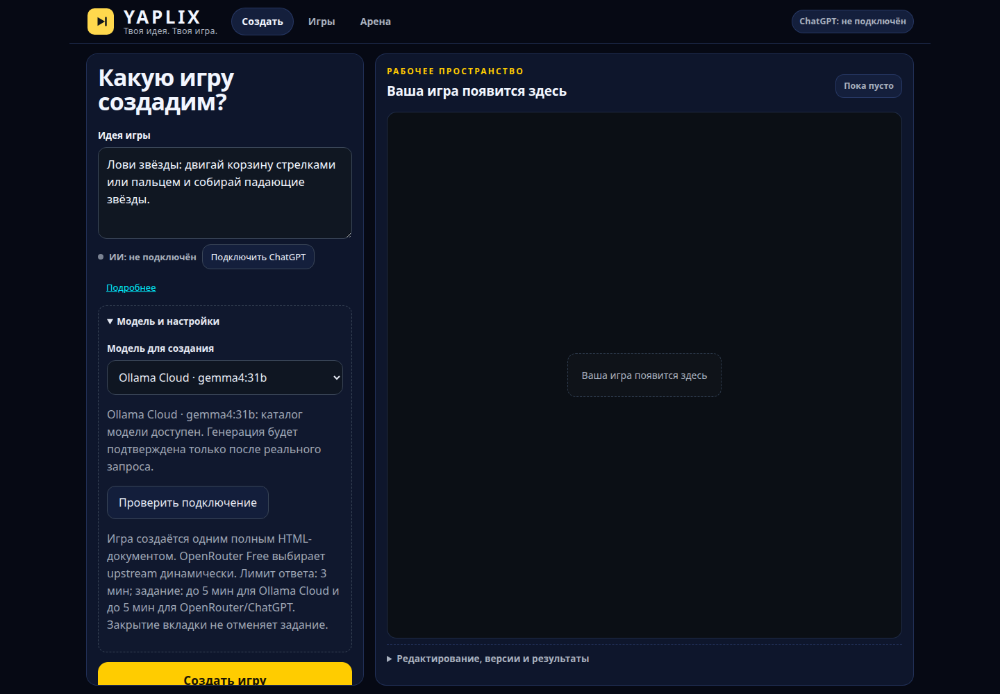
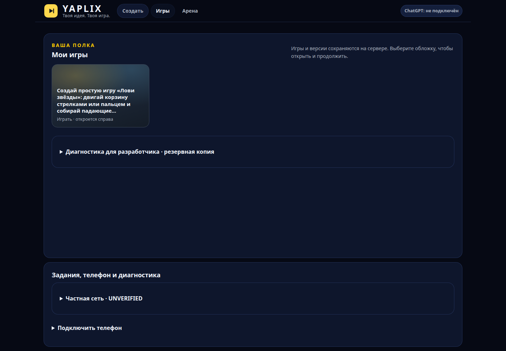
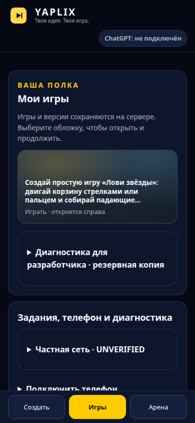
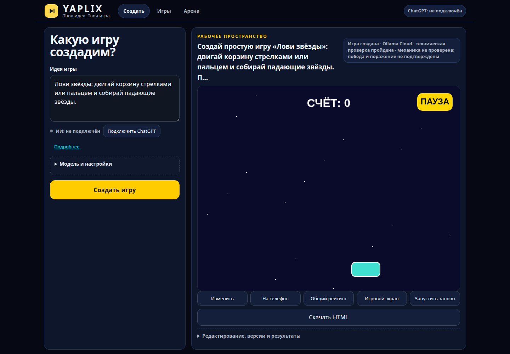
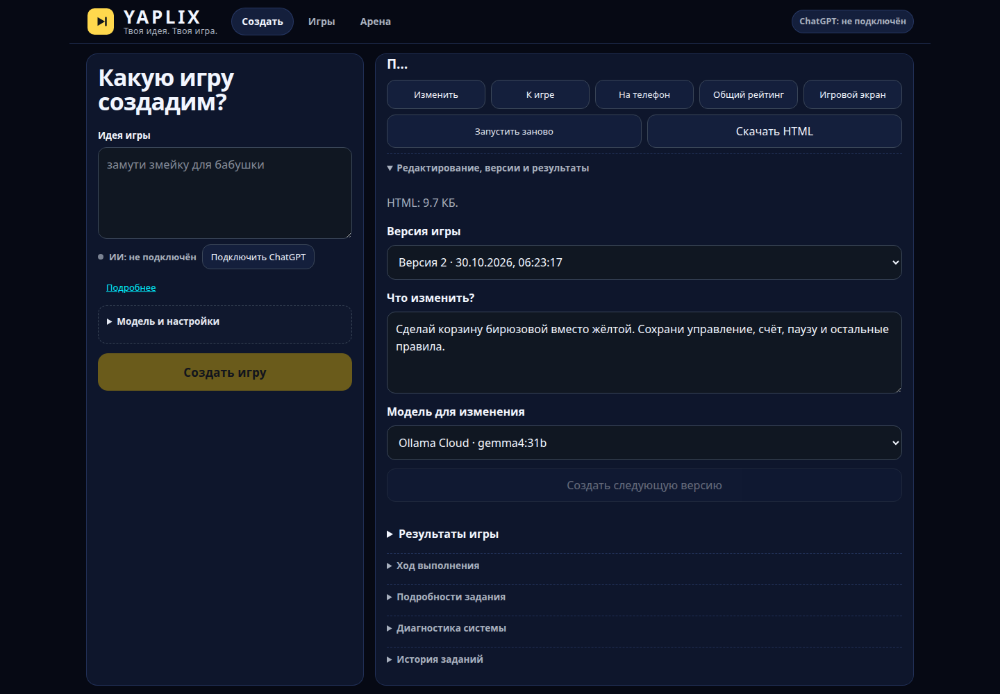
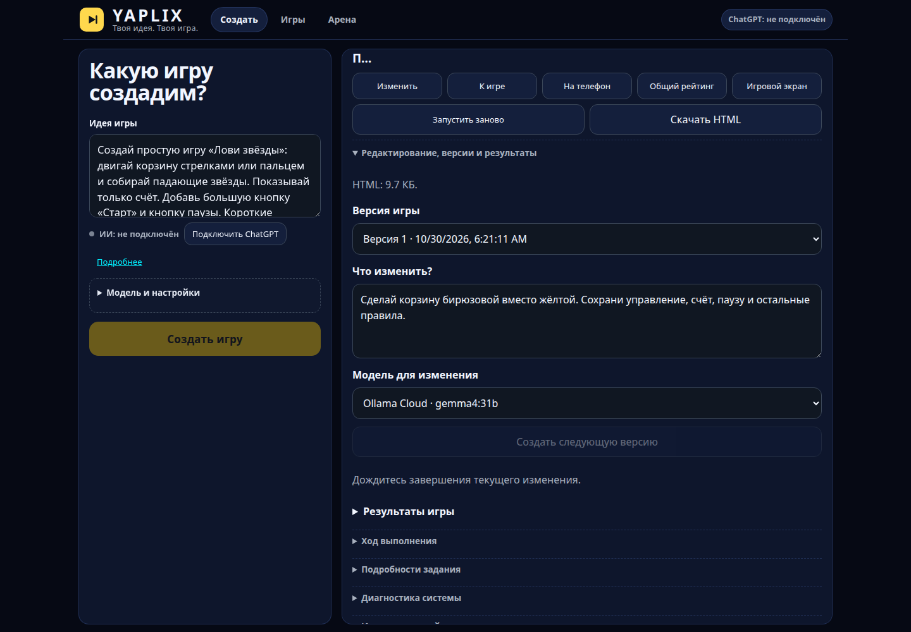

<div align="center">
  <h1>YAPLIX</h1>
  <p><strong>Ты придумал. Теперь играй.</strong></p>
  <p>Создавайте браузерные игры по обычному текстовому описанию — без ручного программирования.<br>
  YAPLIX обращается к выбранной AI-модели, проверяет HTML, сохраняет игру и позволяет менять её новыми запросами.</p>
  <p>
    <a href="https://github.com/Sashido01/YAPLIX/releases/latest"><strong>Скачать YAPLIX</strong></a> ·
    <a href="#быстрый-старт">Быстрый старт</a> ·
    <a href="#как-это-работает">Как это работает</a> ·
    <a href="docs/ROADMAP.md">Дорожная карта</a>
  </p>
</div>



*Опишите игру в поле слева и выберите модель. Справа появится результат генерации.*

## Как это работает

Напишите, например:

> Сделай космическую аркаду: управляй кораблём стрелками или пальцем,
> уворачивайся от астероидов и зарабатывай очки. Добавь уровни и кнопку «Играть снова».

YAPLIX запрашивает **полный HTML5-документ** у модели, проверяет безопасность
и техническую работоспособность результата, а при поддерживаемой ошибке
может предложить модели исправление. Готовая игра появляется в вашей библиотеке.

| Создать | Играть | Изменить | Поделиться |
| :--- | :--- | :--- | :--- |
| Опишите идею и выберите модель | Откройте игру и попробуйте управление | Попросите AI добавить механику или изменить оформление | Скачайте автономный HTML или используйте доступ по QR в локальной сети |

**Важное различие:** техническая проверка не гарантирует, что любая сгенерированная
игра полностью соответствует задумке. Сложные правила и игровые состояния стоит
проверять самостоятельно.

## Как выглядит интерфейс

В YAPLIX три раздела: **«Создать» · «Игры» · «Арена»**.
Создавайте и меняйте игры в одном рабочем пространстве, а сохранённые результаты
открывайте из библиотеки.



*Нажмите обложку в разделе «Игры», чтобы открыть сохранённую игру и её версии.*

<p align="center">
  
</p>

*Та же библиотека на узком экране. Переключайте разделы нижней панелью.*

Снимки получены из настоящего Ubuntu Lite v0.0.1 в изолированном браузерном
профиле. Игра создана реальным запросом к Ollama Cloud; мобильный снимок —
viewport 390×844, а не физический телефон. Статус личного ChatGPT в этой версии
показывается отдельно от выбранного Ollama Cloud.

## Быстрый старт

### 1. Установите приложение

Перейдите на страницу **[последнего релиза](https://github.com/Sashido01/YAPLIX/releases/latest)**
и выберите пакет для своей системы.

| Система | Что скачать | Особенности |
| --- | --- | --- |
| **Windows 10/11, x64** | Windows Lite или Full (`.exe`) | Готовый установщик. Полная и облегчённая поставки различаются набором браузерных компонентов |
| **Ubuntu 24.04, x64** | Ubuntu Lite (`.zip` с `.run`) | Lite использует совместимый Google Chrome; установка в профиль пользователя без `sudo` |

Проверяйте целостность скачанных файлов по `SHA256SUMS.txt` из релиза.
Если не уверены в выборе пакета, следуйте **[инструкции по установке](INSTALL.md)**.
Поддержка других систем и физических устройств проверяется отдельно.

### 2. Подключите AI-модель

После установки откройте **«Настроить AI YAPLIX»**, выберите **Ollama Cloud**
и введите **собственный API-ключ**. Перезапустите YAPLIX, в разделе
**«Создать» → «Модель и настройки»** выберите **Ollama Cloud · gemma4:31b**.

Ключ хранится на стороне сервера, а не внутри HTML-игры. Для новой генерации
необходимы доступ к выбранному провайдеру и интернет. Режим OpenRouter Free
доступен как экспериментальный, но его результат зависит от динамически
выбранной upstream-модели.

### 3. Создайте первую игру

Откройте **«Создать»**, напишите короткую идею и нажмите **«Создать игру»**.
Дождитесь генерации и проверки. Если AI вернёт неподходящий HTML, YAPLIX
покажет результат проверки; поддерживаемые исправления выполняются с
ограниченным числом повторных запросов.

### 4. Запустите игру

Откройте игру из уведомления или раздела **«Игры»**, нажмите стартовую кнопку
внутри игры и попробуйте управление. Кнопки и правила зависят от вашей идеи
и результата модели.



*Нажмите «СТАРТ», затем двигайте корзину стрелками. Для этой игры запуск и
движение клавиатурой проверены через GUI.*

### 5. Измените игру и выберите версию

Нажмите **«Изменить»** и опишите пожелание, например:
«Сделай корзину бирюзовой вместо жёлтой. Сохрани управление и остальные правила».
Выберите модель и нажмите **«Создать следующую версию»**.



*Новая версия сохраняется отдельно. Список «Версия игры» позволяет открыть
предыдущий результат; кнопка «К игре» возвращает в проигрыватель.*

<details>
<summary>Как выглядит генерация новой версии</summary>



*Дождитесь ответа модели и проверки результата. Повторная отправка временно
недоступна; закрытие вкладки само по себе не отменяет задание.*

</details>

### 6. Скачайте автономный HTML

Нажмите **«Скачать HTML»**. Полученный файл можно открыть в браузере
**без сервера YAPLIX и без подключения к модели**. Создание новых игр
и AI-редактирование по-прежнему требуют подключённого провайдера.

## Что ещё умеет YAPLIX

- **Библиотека и версии.** Сохраняет ваши игры в SQLite, позволяет вернуться к предыдущим изменениям и переживает перезапуск приложения.
- **AI-редактирование.** Новое пожелание отправляется модели вместе с существующим HTML; прежняя версия не перезаписывается.
- **Автономные игры.** Один HTML со встроенными стилями и JavaScript без обязательных внешних ресурсов.
- **На телефон.** Временный QR-доступ к сохранённой игре в доверенной локальной сети при работающем сервере YAPLIX.
- **Арена.** Комнаты и общий рейтинг для игр, поддерживающих специальный контракт результатов. Не каждая игра автоматически совместима с Ареной.
- **Изолированное выполнение.** Игровой код открывается в sandboxed iframe с ограничениями CSP.

## Кому пригодится

**Тем, кто хочет придумать игру, но не хочет писать код:** начните с короткой идеи,
поиграйте, затем улучшите механику через новый запрос.

**Тем, кто экспериментирует с AI и разработкой игр:** сравнивайте жанры,
сохраняйте версии и экспортируйте автономный результат для дальнейшего использования.

## Вопросы и ответы

<details>
<summary><strong>Можно пользоваться YAPLIX без интернета?</strong></summary>

Ранее сохранённую HTML-игру можно открыть автономно. Для создания и
редактирования новой игры через Ollama Cloud требуется соединение с провайдером.

</details>

<details>
<summary><strong>Нужен ли API-ключ?</strong></summary>

Да, для генерации через Ollama Cloud используйте собственный ключ. Без ключа
доступны локальные уже сохранённые игры. Не публикуйте ключи или файлы `.env`.

</details>

<details>
<summary><strong>Почему игра может не запускаться или не пройти проверку?</strong></summary>

Результат зависит от модели и сложности запроса. YAPLIX проверяет HTML,
ограничения безопасности и наблюдаемое поведение в браузере, но не может
достоверно оценить каждую произвольную механику. Подробности — в
[документации по проверке](docs/game-validation.md).

</details>

<details>
<summary><strong>Можно ли играть с телефона?</strong></summary>

Интерфейс и сгенерированные игры рассчитаны на сенсорные экраны, но конкретная
игра может потребовать доработки управления и адаптивности. Для QR-доступа
нужны работающий YAPLIX и одна доверенная сеть. См.
[инструкцию для телефона](docs/phone.md).

</details>

## Разработчикам

YAPLIX использует **TypeScript, Node.js 24, Hono, SQLite, Chromium/Playwright
и HTML5 Canvas/WebGL**.

Запуск из чистого клона при установленном Node.js 24.18+:

```bash
git clone https://github.com/Sashido01/YAPLIX.git
cd YAPLIX
npm ci
npm run checker:install
```

Создайте локальный `.env` для собственной модели:

```dotenv
LIVE_PROVIDER=ollama-cloud
OLLAMA_CLOUD_API_KEY=your-own-key
```

```bash
npm run app
```

Откройте адрес, который выведет приложение. Не коммитьте `.env`,
игровую базу данных и личные файлы.

Проверки:

```bash
npm run check:quick
npm run check:integration
```

Обязательные интеграционные проверки и самостоятельные LIVE-прогоны
имеют разные границы подтверждения.

## Документация и развитие

[Установка](INSTALL.md) ·
[Руководства](docs/README.md) ·
[Архитектура](docs/architecture.md) ·
[Арена и QR](docs/arena.md) ·
[Дорожная карта](docs/ROADMAP.md) ·
[Известные ограничения](docs/known-errors.md) ·
[Презентация](docs/presentation.html) ·
[Авторы и вклад](AUTHORS.md)

Выпущенные версии и установщики находятся в
[GitHub Releases](https://github.com/Sashido01/YAPLIX/releases).
Новые предложения и воспроизводимые ошибки можно оставить в
[Issues](https://github.com/Sashido01/YAPLIX/issues).
