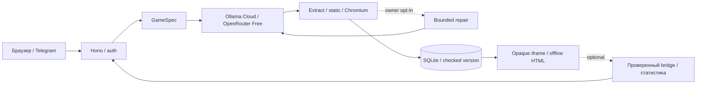

# Архитектура YAPLIX

Аудит MICRO-036.2: 18 октября 2026, main `942387eb1fc06792767bddf2ae766cd0ed4676ff`.
Текущее ограничение Save/Ready: [несовместимость browser metadata](game-validation.md#контракт-browser-metadata--блокер-micro-0362).

Один Node 24.18+ (24.x) процесс: Hono API, лёгкий frontend, собственный generator,
SQLite и sandbox. TypeScript/esbuild; Node/Chromium/модели устанавливаются только
на сервере, телефон использует браузер. Нет внешнего локального проекта-источника.

## Собственная генерация — Full HTML core (MICRO-023)

`User idea → generationMessages → LLM → prepareDocument → static/browser validator
→ atomic GameVersion`. Один запрос на обычную успешную генерацию; нет отдельных
LLM stages для компонентов. [GAME_GENERATION_CONTRACT](../src/generation.ts)
требует полный самостоятельный HTML5 со встроенными CSS/JS, механиками идеи,
рабочим desktop/touch управлением, целью, уместными win/loss, restart и оформлением.
Canvas/DOM выбирает модель. Нет обязательного genre classifier, line cap, движка,
фиксированных mechanic IDs, Visual Kit/GameDNA/achievements/telemetry.

Редактирование отправляет current version HTML целиком, исходную идею и новое
требование, с сохранением существующих механик. История повторных запросов не
отправляется. Нельзя обрезать HTML для контекста: входной envelope ≤300000 bytes;
при известном context_length используется консервативная оценка UTF-8 bytes плюс
output budget. Это оценка, не tokenizer и не гарантия неизвестного upstream.
При отказе исходная версия сохраняется. SQLite transaction связывает next version,
previousVersionId и completed job; idempotency предотвращает дубликаты.

Production routes: gemma4:31b на exact https://ollama.com/v1 (server key) — default;
openrouter/free на exact https://openrouter.ai/api/v1 — только явный выбор.
Legacy auto также только Ollama, даже при единственном OpenRouter key. Ошибки
Ollama не дают право dispatch OpenRouter. В editor оба тех же provider select.
Фактический upstream OpenRouter сохраняется в diagnostics и не фильтруется как
concrete requested model. Paid/local/generic routes и obsolete model/fallback knobs
не разрешены. [Общий network transport MICRO-021](llm-network.md) сохраняет
Direct/Auto/mandatory HTTP(S) proxy, TLS, no redirects и освобождение Agent.
`network:check --all` диагностирует оба provider GET, не authorize inference.

[transport.ts](../src/transport.ts) сохраняет SSE terminal/stop/model checks,
usage и partial checkpoints. `finish_reason=length` не может стать готовой игрой.
Output default 12000 tokens, config 256..32000, известный completion cap снижает
budget; для durable jobs budget <2048 блокирует POST. Это не гарантия качества.
HTML/original/checkpoint cap 200000 UTF-8 bytes, response cap 1210000 bytes.
Слишком большой response — LLM_RESPONSE_BODY_TOO_LARGE; внешний HTTP 413 —
LLM_HTTP_BODY_TOO_LARGE (сам по себе не различает provider и proxy).
SSE frame может занимать весь прежний wire budget: JSON escaping не равен размеру
HTML. Извлечение снимает только целый Markdown fence; не ищет HTML-подстроку,
не режет документ по первому closing tag и не переписывает JavaScript regex.

[Jobs](../src/jobs.ts): существующие durable state, checkpoints, cancellation,
cooldowns и exclusive worker lease. Default 4 calls / 4 runs / 300 s; request
≤60 s; manual Continue сохраняет lifetime ≤12. Повтор не меняет provider;
legacy Auto checkpoint от OpenRouter при несовместимом route остаётся доступным,
но блокирует recovery без POST. Queue 20/3, jobs 1000, originals/checkpoints ≤100 MB.
Первый raw ответ сохраняется в originalCheckpoint, последний — checkpoint;
bounded diagnostics не попадают в summary/Git. Старые игры/версии/задания не мигрируются
и не удаляются. Legacy DEMO API/fixtures доступны тестам, основной UI создаёт live.

[Validator](game-validation.md) сохраняет OS sandbox, opaque iframe/CSP,
offline, runtime/Promise errors, startup/restart probes и bounded recovery.
`full-html` probe не требует platform markers/bridge. Legacy `data-yaplix-start`
выбирает существующий строгий lifecycle gate `startup-input-pause`, включая pause,
resume, events и marked restart reset. Доступные generic controls проверяются
реальными действиями, но без известного read-only state их mechanics/restart
остаются NOT_VERIFIED. UI сообщает технический результат отдельно от gameplay.
Оба gate имеют общий deadline 18 s. Legacy gate использует 320×700/390×700;
Full HTML — 320×700, 390×700 и 844×390. Это browser emulation, не physical devices.
Full HTML проверяет touch без keyboard fallback; hit-test избегает canvas под
стартовым overlay, после реального tap повторно наблюдаются открывшиеся controls.
Landscape отклоняет лишь доказанно недоступные ранее наблюдавшиеся controls без
реальной прокрутки (`BROWSER_CONTROLS_UNREACHABLE`), не все неизвестные состояния.
Возврат этих трёх профилей сейчас несовместим с `parseArtifact`, который принимает
только `[320,390]`: технический checker PASS ещё не гарантирует Save/Ready.
[Точное ограничение и proof](micro-036-2-docs-audit.md#блокер-контракта-full-html).
LLM repair production default off, максимум один после отдельного разрешения.
`repairUsed` durable; Continue/restart не снимают cap. Только два deterministic
format fixes: whole JSON string и missing doctype, с повторным gate.

Локальный `game-intent.ts` используется при opt-in `LLM_PROMPT_STYLE=intent`:
консервативные EXPLICIT/INFERRED/DEFAULT/UNKNOWN hints и compact envelope, без
дополнительного LLM вызова. Code default — direct; сохранность механик и
адаптация произвольного ответа не следуют из разбора текста.

Analytics доступна только играм с добровольным event bridge; базовая генерация
его не требует. Авторские gallery HTML сохраняются authored/unverified и не
подменяют LLM output. Экспериментальный orchestrator не интегрируется в этот core.
[Результаты и ограничения MICRO-023](micro-023-report.md).

## Экспериментальный orchestrator (TASK-013, architecture B)

[orchestrator/](../src/orchestrator/) — отдельный экспериментальный pipeline
`UserPrompt → GameSpec (выведенный без LLM) → MechanicsSelector → MechanicsLibrary
→ LLMGameLogic → HTMLBuilder → ExistingChecker → Artifact`. Production путь выше
(A: LLM пишет полный HTML) остаётся единственным для jobs/UI/API; orchestrator
включается только явным скриптом.

- [spec.ts](../src/orchestrator/spec.ts) выводит OrchestratorGameSpec ключевыми
  словами: spaceType grid/free/mixed/unresolved, entities/movement/interactions,
  буквальные winRule/lossRule regex по исходному промпту. Ничего не выдумывается:
  unresolved не подбирает примитивы. Оригинальный промпт всегда передаётся LLM
  дословно и остаётся главным источником.
- [selector.ts](../src/orchestrator/selector.ts) выбирает substrate из библиотеки
  примитивов [primitives.ts](../src/orchestrator/primitives.ts) (8 primitives:
  canvas, loop, input с touchpad, grid, physics, fsm, score, session). Решение
  техническое, не жанровое: примитивы не задают готовую игру, правила полностью
  пишет LLM.
- [html-builder.ts](../src/orchestrator/html-builder.ts) собирает standalone HTML:
  скелет (#yapStart/#yapPause/#yapState/#yapRestartBtn, CSS 44px targets) + выбранные
  источники примитивов + сгенерированная логика. В LLM уходит только задача «напиши
  новую игровую логику plain-JS ≤350 строк» — не перескраска жанрового шаблона.
- [engine.ts](../src/orchestrator/engine.ts) implements Generator с теми же
  attempt/cooldown/block bookkeeping, что [live.ts](../src/live.ts): single slot,
  bounded repairs, cooldown 900 s для LLM_QUOTA/AUTH/CONTEXT, 60 s для RATE_LIMIT,
  sandbox-fatal без repair/fallback. Fallback «scratch» при unresolved space
  использует полный путь A-стиля. Метаданные OrchestratorRun (spaceType,
  selection, primitiveKeys/bytes, llmCodeChars/sha256, per-stage timings) хранятся
  рядом с артефактом в .local/task-013, не в contracts (strict Artifact).
- A/B протокол: scripts/orchestrator-ab.ts, одна модель gemma4:31b (ollama-cloud)
  для обеих ветвей, ≤2 repairs на попытку, бюджеты ≤6 primary + ≤2 repairs;
  аудит артефактов scripts/orchestrator-audit.ts. Итоги — docs/task-013-report.md.
  Результаты в .local/task-013 (не коммитятся) — это данные эксперимента, не
  production поведение.

### TASK-016: обязательные правила игры и доказательство достижимости

- OrchestratorGameSpec (spec.ts) несёт блок `rules` — objective, actions,
  interactions, progress, win, loss, restart, mobile, userRulesPriority.
  Дословные условия пользователя из промпта всегда выигрывают (sentence-level
  regex); documented defaults выводятся из резолведного space (lives → loss
  жизней, enemies → захват, grid → переполнение, collectibles/score → цель
  счёта); на unresolved правила не выдумываются.
- engine.ts передаёт LLM MANDATORY RULES block точно как исполняемые проверки
  состояния («win и loss должны быть оба достижимы; loss-only games запрещены»)
  + rules banner (Goal/Lose/Win/Controls) в видимый `#yapBanner` артефакта;
  run metadata включает rules.
- [gameplay-check.ts](../src/orchestrator/gameplay-check.ts) — evidence checker
  поверх механик browser-check.ts: real-сессия Start → input probe →
  generic sweeps или scripted sequence → terminal drive → idle stretch →
  restart probe. Аспекты html-runs/input-works/gameplay-observed/
  win-reachable/loss-reachable/restart-works получают VERIFIED (доказано
  реальной сессией), NOT_VERIFIED (не доказано автоматикой в бюджет —
  никогда не PASS), FAILED (доказано сломано). Пиксельная активность без
  state-доказательств (HUD states/score events) геймплеем не считается.
- Контролируемые регрессии tests/orchestrator.spec.ts: tetris+взрывы (win =
  2 линии guided drops, loss = переполнение idle) и snake+враги (win = 5
  яблок по trail через «вперёд-спавн», loss = захват врагом при idle) —
  реальная автоматическая игра доказывает достижимость обоих концов.
- Аудит артефактов: scripts/orchestrator-gameplay-audit.ts (.local/task-016);
  итоги и honest evidence по live-прогонам — docs/task-016-report.md.

### TASK-017: отдельная rules-aware проверка без новой генерации

`gameplayCheck(html, rules, {rulesAware: ...})` запускает post-generation probe;
production generator, jobs, UI и durable storage его не вызывают. Старый
`summarizeSession` больше не выдаёт win VERIFIED только по `game_won`.

[rules-probe.ts](../src/orchestrator/rules-probe.ts) интерпретирует одну
кумулятивную числовую цель score/items/lines/waves из малого словаря rules.win.
Явный порог обязан совпасть с HUD; при generic target допустим однозначный
порог той же метрики из HUD (`target`, `collected: n/N`). Примеры objective и
loss не используются. Compound/unknown wording, конфликт и недостаток evidence
никогда не превращаются в VERIFIED.

[rules-gameplay.ts](../src/orchestrator/rules-gameplay.ts) читает DOM HUD и
пиксели нарисованного canvas, нажимает настоящие кнопки/клавиши. Для явно
настроенной геометрии/палитры змейки BFS выбирает следующий безопасный шаг до
яблока; каждый прирост дополнительно сверяется с входом головы в предыдущую
клетку яблока. Реальные Pause/Continue позволяют наблюдать и планировать ход.
Generic sequences годятся для простых проверяемых HUD-сценариев; автономный
прирост baseline не доказывает влияние input. Универсального игрового AI нет.

Win VERIFIED требует правила + исходного прогресса до первого gameplay input +
действий + порога HUD + согласованной последовательности win/end + устойчивого
видимого completion в двух наблюдениях. Проверяется viewport/visibility/opacity/
перекрытие result. Unexpected ready/start/reload не может смешать разные run.
Restart выполняется после запечатывания первого proof: reload, новые ready/start,
сброс прогресса, реальный ввод и изменение изображения в активном новом run.
Bridge дополнительно фильтруется по source/origin/session/version/protocol/sequence.
Это наблюдательное evidence, не гарантия против специально сфальсифицированного
HUD в произвольном недоверенном HTML; визуальные адаптеры дают дополнительный
независимый сигнал. Win-event сам по себе недостаточен.

Активный probe budget 2–180 s начинается после настоящего game_started;
общий watchdog budget + 12 s включает browser startup. Pending FIRE/Pause
отменяется при terminal event, если завершение возникло между наблюдением и
actionability click; proof всё равно требует независимого подтверждения.
Ограничения: 1000 action records,
2048 samples и 512 bridge events. Оpaque iframe, offline, OS sandbox, CSP и
secrets-free browser environment сохранены. Прямого доступа к переменным,
RNG/таймерам/победе или вызова игровых функций из Playwright нет.

`node scripts/orchestrator-gameplay-audit.ts [b-prompt-1|b-prompt-2]` читает
неизменённые HTML и metadata TASK-016; никакого LLM dispatch. Результаты,
action/sample timelines и PNG пишутся в новый `.local/task-017/<timestamp>/`.
Для clean clone доступны controlled tests; исходные LIVE HTML локальны.
Реальные результаты и пределы: [TASK-017 report](task-017-report.md),
[переносимое evidence](task-017-evidence.json). Решение — ITERATE.

## Runtime и доступ

Opaque iframe `sandbox=allow-scripts`, без same-origin. CSP блокирует connect/frames/
workers/forms/base/objects; inline JS/CSS разрешены. Bridge проверяет конкретный
contentWindow/origin null, IDs/protocol/size/sequence. Parent держит HTTP token;
игре передаются только session/version IDs. Queue 128, message rate 60/s, version
cache 3. Unmount удаляет iframe/listener. События — недоверенная клиентская статистика.

Job polling обновляет только центр/каталог/toast, сохраняет активный игровой realm
при навигации между разделами и не выбирает новую игру. Явное «Открыть»/смена версии
или pagehide закрывают прежний realm. В background polling прекращается; jobs
продолжаются на сервере. Toast server claim предшествует показу: повторный toast
не планируется, crash может оставить результат только в центре/каталоге.

Local loopback; LAN выбранный private IPv4 + key/cookie. HTTPS loopback за proxy,
точные Host/Origin/forwarded scheme, Secure cookie. Generation: 6/min на principal,
12/min globally, один активный запрос. Общая библиотека без ownership/ролей;
публичный Telegram ограничен одним владельцем, несколько ID блокируют HTTPS startup.

## Ограниченный доступ телефона (MICRO-036.1/036.2)

`PhoneConnection` внутри того же процесса/Store слушает только выбранный физический
LAN IPv4. Default TCP 52604, override `YAPLIX_PHONE_PORT` из локального `.env`;
фиксированный порт переживает refresh/restart, конфликт даёт `PORT_IN_USE` без
random fallback. Owner API на этом listener отсутствует. TTL 30 минут, fragment
→ bounded POST → HttpOnly/SameSite cookie; refresh отзывает старый token/cookie,
disable/shutdown закрывают listener. Firewall автоматически не меняется.
[Owner-confirmed Android/Brave scope и пределы provenance](micro-036-stable-phone-port.md#micro-0362--физическая-приёмка-подтверждение-владельца).

## Telegram и shares

TelegramBot получает updates в том же backend независимо от Mini App/tunnel.
Token + single owner включают команды start/games/new/status/help; явный
TELEGRAM_UPDATES=off выключает poller. Каталог читается из существующей DB,
не подставляется из вымышленного списка. Webhook/consumer conflict не обходится.
Один consumer и offsets координируются отдельно от game DB; offset фиксируется
до отправки ответа, поэтому crash может потерять reply. Exactly-once доставки нет.
Проверенный текущий HTTPS нужен для web_app кнопок; без него бот остаётся текстовым.

Официальный SDK только на `/telegram`, lazy adapter и тот же frontend. Backend
проверяет HMAC, auth age (default 300 s), TELEGRAM_ALLOWED_USER_IDS; initDataUnsafe
не доверяется. Сессии 1 h, 1000 максимум, hashed tokens. HttpOnly/Secure cookie и
memory-only header-token для blocked third-party cookies; никаких tokens в URLs,
storage/game/postMessage. Theme/viewport/safe-area по SDK events, Back → library,
pagehide снимает listeners. [Настройка HTTPS](telegram.md).

Share — подписанная server key HTTPS-ссылка на одну immutable version, TTL 7 дней,
не авторизует API/history/backup/sessions. HTML под opaque CSP/no-store/no-referrer.
Key rotation отзывает ссылки. `/telegram?game=UUID` требует обычный signed вход.
`/?game=UUID&version=UUID` и Telegram equivalent выбирают сохранённую версию только
после обычной авторизации; game/version association проверяется клиентом. Ссылки
не дают multi-tenant изоляцию общей библиотеки и не передают HTML/ключи.

Telegram notification разрешено согласившимся signed users. После отсутствия job
polling ≥30 s сервер пробует отправить кнопку конкретной game/version через своего
бота, только при HTTPS/single owner. Claim записывается до network dispatch; после
unknown delivery повтор не выполняется. Это at-most-once attempt, не гарантия
доставки или exactly-once distributed notification. Web Push вне страницы нет.

## Данные и Evolution

Schema v2: прежние games/versions/sessions/events плюс generation_jobs/generation_worker,
FK/WAL/prepared SQL. TASK-009 мигрирует исправную v1 transaction с защитной
проверенной `.local/backups/before-v2-UUID.sqlite` копией. Старые HTML/metadata
не переписываются; пустая новая DB создаётся сразу в v2 без migration snapshot.
[Restore/update](development-setup.md) учитывает v1/v2 и snapshots.
TASK-007 до этой миграции сохранял schema v1. Старые versions без generation evidence
валидны. Title библиотеки берётся из первого prompt, не repair instructions.
Лимиты: 100 MB HTML, 10000 versions/sessions, 100000 events, 1000 events/session.
Session token SHA-256, TTL 1 h. eventId/payload retry идемпотентен; изменённый payload
конфликтует. Ready → Started → Score/один Outcome → End; End закрывает сессию.

Аналитика: issued/started/completed, won/lost, последний score, end-start duration,
winRate=won/started. Без наблюдений средние null. Comparison только same game:
<5 completed на сторону insufficient_data, иначе preliminary без причинных выводов.
Автоматического переобучения/эволюции нет. Online backup проверяет integrity/FK/schema
и SHA-256; [restore/update](development-setup.md). Sandbox не гарантирует CPU/RAM
изоляцию; exported HTML теряет HTTP CSP и проверяется offline отдельно.

## Runtime / tunnel lifecycle

`npm run tunnel -- --menu`: совместимый local backend этого клона проверяется
HTTP readiness + HMAC nonce/protocol/instance через `/api/runtime/tunnel`.
Control key только в `.local/runtime-control.key`, не в connector environment.
Private loopback POST готовит закрытый HTTPS режим, устанавливает exact origin и
lease heartbeat; без heartbeat через 20 s публичные запросы закрыты. Перед переходом
в local launcher ждёт close connector. Local mode отвергает forwarded requests.
Own backend закрывается по IPC disconnect; existing backend не получает kill.

Публичный `/healthz` содержит только app/protocol/instance/ready. Внешний HTTPS
должен вернуть именно этот экземпляр до меню Telegram. URL/process/health deadlines,
bounded redacted process journal, conditional Telegram menu reset и повторный запуск
описаны в [Telegram runtime](telegram.md). Client bundle не управляет процессами.
