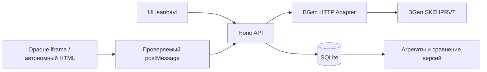

# Архитектура платформы (TASK-002 / TASK-003)

## Реализованная вертикаль

Это один локальный процесс, а не набор сервисов. `src/api.ts` управляет записью
игр/версий, сессиями и событиями; `src/store.ts` хранит HTML и метаданные;
`src/bgen.ts` вызывает генератор. Полноценный UI остаётся за jeanhayl, генерация
и доработка кода — за SKZHPRVT. Бренд YAPLIX сохранён.

Стек: Node 24.18+, TypeScript, Hono + Node adapter, встроенный `node:sqlite`,
prepared SQL без ORM. Версия приложения 0.0.1 — внутренний foundation, без релиза.
SQLite API на Node 24 пока experimental; используется только проверенный небольшой
набор DatabaseSync/prepare/transaction. Синхронный SQL подходит ограниченной
локальной демонстрации; production concurrency и auth — последующие задачи.

## Хранение и Evolution Data

Миграция 1 атомарно создаёт `games`, `versions`, `sessions`, `events` и
`PRAGMA user_version=1`. Более новая схема отклоняется. SQLite FK включены,
WAL используется на диске. Health выполняет integrity_check и foreign_key_check.
База по умолчанию `.local/data/yaplix.sqlite`; абсолютные/относительные пути
за пределами управляемого `.local` отклоняются. База/HTML не исполняются сервером.

Версия содержит spec, предыдущую версию, исходный HTML, SHA-256 UTF-8 HTML,
provider/model (null при неизвестных), время UTC, способ получения и два отдельных
статуса: generationStatus и validationStatus. Метаданные истории возвращаются
без HTML; конкретная версия возвращает артефакт JSON. Проверка структуры HTML
не доказывает играбельность. Импорт API разрешён только для mock/unverified:
клиент не может пометить авторскую тестовую игру как LLM или проверенную.
`GET /api/versions/:versionId/export` выдаёт точный исходный UTF-8 HTML как
attachment, с X-Content-SHA256 и ограничивающим CSP для HTTP-ответа. При сохранении
файла HTTP CSP не сохраняется: автономный HTML по-прежнему недоверенный, его
испытание проводится в изолированном браузере offline.

Лимиты: HTML 200 000 UTF-8 bytes; всего 100 MB HTML и 10 000 версий;
10 000 сессий; 100 000 событий; 1 000 событий на сессию. При исчерпании
квоты API прекращает запись. Автоматического удаления истории нет.
События имеют UUID, sequence, timestamp; повтор того же eventId/payload
идемпотентен, изменение payload — конфликт. Токен сессии хранится как SHA-256;
срок 1 час. События идут по sequence от 0 с неубывающим временем, clock skew
до 5 минут. Нужен game_started перед score/outcome/end; один outcome;
session_ended закрывает сессию. game_error может предшествовать старту.

Аналитика: sessionCount — все выданные сессии; startedCount — начатые;
completedCount — session_ended; won/lost — сессии с outcome;
winRate = won / startedCount; meanDurationMs — среднее end-start завершённых;
meanScore — последний счёт каждой сессии, передававшей score_changed.
Без наблюдений средние/доля null, счётчики 0. Outcome может быть записан до
session_ended. Незавершённые игры входят в знаменатель доли побед.

Сравнение доступно только разным версиям одной игры. До пяти завершённых
сессий на каждой стороне — insufficient_data; после — preliminary, всегда
описательный результат по недоверенным данным, без причинных выводов.
Возвращаются разницы длительности и доли побед, исходные агрегаты и замечания
для будущего LLM-контекста. Автоматических изменений кода и ИИ-эволюции нет.

## BGen: проверенный аудит и границы

Read-only аудит BGen HEAD `419c64968d487068a2fbed2e4bd99489cc734430`
13 октября 2026. MIT: copyright 2026 SKZHPRVT. Исходники BGen не копировались
и не менялись; временная копия находится в игнорируемой `.local/BGen`.

- `/api/generate` принимает prompt (2–500 символов), audience, theme и optional
  previousCode/previousPrompt; `/api/iterate` требует previousCode (до 200 000
  символов) и новый prompt. Ответ: html, provider, ok, fromCache, warnings и
  служебные поля; model и generation method отсутствуют.
- `core/src/index.ts` использует 12 жанровых шаблонов: LLM возвращает конфиг;
  при ошибке — defaultConfig. provider `engine+...` отражает этот путь.
- `llm/router.ts` автоматически добавляет Mock при отсутствии доступных LLM.
- `iterate` передаёт previousCode в UserInput, но fresh pipeline вызывает
  `compile(userInput, { examples })`, а compiler читает `opts.previousCode`.
  Исходный HTML до компилятора не доходит. Шаблонный путь также пересобирает игру.
- `llm/providers/gigachat.ts` передаёт `tls: { rejectUnauthorized: false }`
  в OAuth и chat fetch. Это блокер безопасного production-подключения GigaChat.
- Телеметрия BGen измеряет генерацию, не игровые сессии. 13 октября 2026 HTTPS
  `https://bgenserver-production.up.railway.app/` и `/api/health` вернули 200;
  `/api/capabilities` — 404. Это подтверждает доступность, но не SHA развёрнутого
  кода, наличие безопасного LLM, играбельность или происхождение игр.

Наш адаптер ограничивает запрос/ответ, таймаут включая чтение body, запрещает
redirect, HTTP кроме loopback и credentials в URL. Не переключается на Mock.
Legacy `engine+openai|anthropic|ollama|gigachat+json|keyvalue` → template_config;
`engine+mock+...` → mock; `engine+default` → fallback. Legacy cache/manual/raw
provider отклоняются с BGEN_PROVENANCE_REQUIRED: информации недостаточно.
Добавленная поддержка provenance v1 — **предложенный**, пока не внедрённый BGen
контракт; пример и ограничения находятся в [development-setup](development-setup.md).
provider/model — утверждения генератора, не криптографическое доказательство.
`ok` BGen соответствует generationStatus; playability остаётся unverified.

Для конкурсного запроса UI передаёт `requiredMethod: "llm_code"`. До любого
generation POST адаптер проверяет предложенный `/api/capabilities` v1: SHA
revision, codeGeneration=true, tlsVerification=true, previousCode boolean.
Известный небезопасный SHA 419c649 отклоняется даже при декларации TLS=true;
новые SHA требуют review владельца и исходников. Декларация capabilities не
доказывает проверку upstream TLS сама по себе. Передавать false/неизвестное
значение вместо честного true обязательно, пока исправление не готово.
Preflight ограничен 4096 bytes и 15 секундами, redirects запрещены.
NODE_TLS_REJECT_UNAUTHORIZED=0 отклоняется и при прямом вызове адаптера.

Строгий запрос требует succeeded + provenance llm_code + непустые provider/model.
При iterate отправляются предыдущий HTML и его SHA-256; ответ должен подтвердить
previousCodeSha256, capabilities.previousCode должен быть true. Это проверяемое
утверждение сервиса о входе, не доказательство использования кода моделью.
Нужны исправление CompileOptions в BGen и поведенческий браузерный тест.
Ошибки не создают GameVersion. Обычные template_config/mock/fallback остаются
доступны через прежний режим; запрещено выдавать их за конкурсный llm_code.

`scripts/live-generation.ts` оркестрирует существующий API без второго UI или
генератора: две независимые игры, затем изменение первой, SQLite и точный экспорт
с readback/hash. При ошибке сохраняет partial evidence и выходит с кодом 1;
отсутствие событий записывает как not_observed, проверку браузером — not_run.
Артефакты и run database игнорируются Git. При нынешнем endpoint preflight
останавливается до generation POST, версий нет. Полная цель TASK-003 не достигнута.

## Runtime и Mobile First

`mountGame` — маленькая библиотека для UI, не второй frontend. iframe sandbox
содержит только allow-scripts: origin opaque, без same-origin, popups, forms,
top navigation и доступа к storage/DOM платформы. CSP предшествует HTML:
default-src none, connect/frame/worker/object/form/base запрещены; inline script
и CSS, data/blob изображения/медиа разрешены. Внешние ресурсы не поддерживаются.
Игра должна содержать viewport, touch/keyboard управление и весь код внутри HTML.

События принимаются только от конкретного contentWindow с origin null,
проверяются протокол, IDs, формат, размер. Bridge ограничен 60 входящими
сообщениями/секунду; при отключении iframe listener удаляется. Игра получает
IDs, родитель держит HTTP-токен и последовательную очередь отправки/повторов.
Игра скомпрометированного игрока всё равно может подделать свою статистику.
Токены не доказывают честность рекордов.

Sandbox/CSP не дают гарантий CPU/memory изоляции или полной блокировки сетевой
навигации самого iframe: вредоносная игра может навигировать свой frame.
Origin после навигации тоже может оставаться opaque/null; одной проверки origin
недостаточно для запрета навигации. Защита от утечки через любую навигацию
требует parent CSP и отдельной WebView политики. Не запускать
такой локальный foundation как публичный production сервис.

Тестовый HTML авторский и маркирован mock; без родителя/postMessage основной
цикл, победа и поражение работают offline. Playwright проверяет Chromium desktop,
Chromium mobile и WebKit mobile 320×568/390×844. Это эмуляция, не физические
Android/iPhone и не доказательство качества реальных LLM-артефактов.
TASK-003 дополнительно проверяет скачанный из API HTML как file:// при отключённой
сети, touch tap на mobile, клавиатуру на desktop, изменение размера Canvas и
devicePixelRatio. Это авторская synthetic fixture, а не полученная от модели игра.

## Повторное использование практик

Из BGen переиспользованы Hono/TypeScript-подход и HTTP-контракты, без переноса кода.
Read-only README MyDevelop использован для принципов project-root isolation,
doctor/check/test, доказательных проверок и явного Git-манифеста; инфраструктура,
данные и конфигурация других проектов не копировались, внешних локальных
зависимостей нет. TASK-001 hooks и Python-проверки сохранены.
