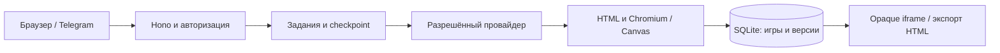

# Архитектура YAPLIX

Один сервер Node.js 24.x обслуживает Hono API, браузерный интерфейс, задания генерации и SQLite. Телефон использует браузер; Node, модель и проверяющий Chromium на телефон не устанавливаются.

## Создание и изменение

[generation.ts](../src/generation.ts) составляет запрос на полный автономный HTML со встроенными CSS/JS. [live.ts](../src/live.ts) получает ответ и передаёт его в статический и браузерный gate. Изменение отправляет весь текущий HTML, исходную идею и новое требование. Прежняя версия не переписывается; сохранение следующей версии и завершение задания связываются транзакцией.

Новые результаты требуют `canvas-webgl-strict-v2`: весь видимый игровой мир, HUD и управление находятся в Canvas/WebGL. Оболочка YAPLIX использует обычный DOM. Старые HTML и metadata читаются без повышения их статуса. [Проверка](game-validation.md), [подробный Canvas-контракт](canvas-rendering-contract.md).

## Провайдеры и задания

Ollama Cloud использует только `gemma4:31b` на `https://ollama.com/v1`. Ручной OpenRouter — только `openrouter/free` на `https://openrouter.ai/api/v1`. Legacy Auto означает Ollama; перехода между провайдерами нет. Личный ChatGPT — отдельный ручной loopback-маршрут Responses с `gpt-6.1-sol`, medium, `store:false`, `stream:true`; OAuth только в памяти.

[jobs.ts](../src/jobs.ts) сохраняет запрос, checkpoint, состояние попыток и отмену в SQLite. Один worker с lease, очередь ограничена. Общие LIVE defaults: response до 30 минут, job до 35 минут вместе с очередью; меньшие явные настройки сохраняют силу. Restart и Continue не продлевают исходный deadline. Для ChatGPT durable reservation разрешает максимум один inference POST за всё время задания, включая ошибки; Continue может только перепроверить полный checkpoint. Для OpenRouter нет автоматического retry/repair; восстановление Ollama ограничено сохранённым бюджетом. [Настройки](chatgpt-setup.md), [сеть](llm-network.md).

## Данные и запуск игры

[store.ts](../src/store.ts) хранит игры, неизменяемые версии, сессии, необязательные события и задания. Кандидат использует schema v3: к играм и заданиям добавлены комнаты Arena, игроки и попытки. Перед миграцией старой базы создаётся проверяемый snapshot. Данные и backups находятся в игнорируемой `.local`; `.env` остаётся серверным. [Обновление и восстановление](development-setup.md#backup-восстановление-обновление).

[runtime.ts](../src/runtime.ts) запускает HTML в opaque iframe `sandbox="allow-scripts"` с CSP. События принимает проверенный bridge; аналитика доступна лишь играм с соответствующим контрактом. Счёт приходит от клиента и не является античитом. Экспорт сохраняет автономный HTML; HTTP CSP за пределами сервера отсутствует, файл открывают offline. Sandbox не обеспечивает полной изоляции CPU/RAM.

## Телефон, Telegram и shares

[phone.ts](../src/phone.ts) открывает временный listener на выбранном частном IPv4, по умолчанию порт 52604. Он выдаёт доступ только к конкретной версии, не к owner API. QR/token имеют ограниченный срок; отключение закрывает доступ. Проверка адреса на ПК не доказывает доступность с телефона. Перед QR выполняется read-only диагностика Windows. Изменения Firewall доступны только через точный план, отдельное согласие и UAC ограниченного helper; без этого правила не меняются. [Настройка LAN](lan-network-setup.md).

Telegram использует тот же frontend по `/telegram`, проверку HMAC/initData, сроков и allowlist. Для внешнего доступа нужны HTTPS и один разрешённый владелец. HTTPS shares открывают одну неизменяемую версию на ограниченный срок. Библиотека общая для допущенного владельца; multi-tenant изоляции нет. [Инструкция](telegram.md).

[Arena](arena.md) использует отдельный частный listener 52605. Комната привязана к неизменяемой versionId и SHA256; игроки получают отдельные cookie и попытки. Bridge принимает прежний score-v1 и result-v1 с критерием версии: очки, время прохождения, дистанция, выживание. Направление сравнения фиксировано; сервер сохраняет завершённый рекорд транзакцией. Несовместимый исторический HTML готовится дочерней версией: точные authored-источники локально, остальные — только по явному LLM-согласию. Это доверенное LAN-демо, не античит и не синхронный multiplayer. Участник не получает owner API. Arena и LAN helper объединены в этом кандидате; [состояние интеграции](release-status.md). Экспериментальные orchestrator и constructor вызываются отдельными скриптами и не заменяют production Full HTML. Их [исторические решения](archive/README.md) сохранены.
