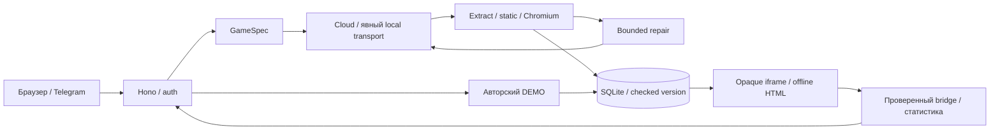

# Архитектура YAPLIX

Один Node 24.18+ (24.x) процесс: Hono API, лёгкий frontend, собственный generator,
SQLite и sandbox. TypeScript/esbuild; Node/Chromium/модели устанавливаются только
на сервере, телефон использует браузер. Нет внешнего локального проекта-источника.

## Собственная генерация

[generation.ts](../src/generation.ts) независимо формирует specification/messages
по собственным GameSpec/event contracts. Нет substring жанровой классификации,
готового каталога, сторонних промптов/шаблонов/assets. Iteration передаёт полный
previous HTML, исходное описание и изменение. [transport.ts](../src/transport.ts)
напрямую вызывает OpenAI-compatible HTTPS или явно выбранную локальную Ollama.
TLS проверяется, redirects запрещены, HTTP только loopback. Секреты только серверу.

[live.ts](../src/live.ts): один active request, общий deadline до 300 s, 0..2 repairs
(default 1), до трёх явно заданных routes. HTTP-ошибка не вызывает скрытого retry.
Cloud default — openrouter/free, OpenRouter запрещает paid model/paid secondary.
Без key отключается только LIVE. Ответ сообщает фактическую выбранную модель. OpenRouter получает low reasoning,
чтобы оставить бюджет для HTML. Truncated output сохраняет actual model в attempts
и может получить тот же один bounded repair, с требованием компактного HTML.

HTML <=200000 UTF-8 bytes, ровно один документ. Static отклоняет external resources,
опасные API, отсутствие mobile viewport/game contract. Затем [browser-check.ts](../src/browser-check.ts)
запускает Chromium с OS sandbox, environment без server secrets, offline, без
popups/dialogs/downloads, deadline 18 s. Реальные Start/input/pause, размеры Canvas,
overflow, порядок/уникальность events, JS/console errors; далее standalone offline.
320/390 px, DPR 2. Проверяется короткий startup-input-pause сценарий, а не полный
путь любой игры до победы/поражения, производительность или безопасность движка.

Только успешный результат llm_code/succeeded/passed записывается. `generation`
хранит requested/actual model, route, rejected/failed/accepted, errorCode/time,
explicit fallback и scope browser evidence. Error API возвращает безопасные codes
и attempts, не raw upstream error. Repair получает original request/failed HTML
и ограниченную техническую обратную связь. DEMO/import маркируются mock/unverified.

## Runtime и доступ

Opaque iframe `sandbox=allow-scripts`, без same-origin. CSP блокирует connect/frames/
workers/forms/base/objects; inline JS/CSS разрешены. Bridge проверяет конкретный
contentWindow/origin null, IDs/protocol/size/sequence. Parent держит HTTP token;
игре передаются только session/version IDs. Queue 128, message rate 60/s, version
cache 3. Unmount удаляет iframe/listener. События — недоверенная клиентская статистика.

Local loopback; LAN выбранный private IPv4 + key/cookie. HTTPS loopback за proxy,
точные Host/Origin/forwarded scheme, Secure cookie. Generation: 6/min на principal,
12/min globally, один активный запрос. Общая библиотека без ownership/ролей;
публичный Telegram ограничен одним владельцем, несколько ID блокируют HTTPS startup.

## Telegram и shares

Официальный SDK только на `/telegram`, lazy adapter и тот же frontend. Backend
проверяет HMAC, auth age (default 300 s), TELEGRAM_ALLOWED_USER_IDS; initDataUnsafe
не доверяется. Сессии 1 h, 1000 максимум, hashed tokens. HttpOnly/Secure cookie и
memory-only header-token для blocked third-party cookies; никаких tokens в URLs,
storage/game/postMessage. Theme/viewport/safe-area по SDK events, Back → library,
pagehide снимает listeners. [Настройка HTTPS](telegram.md).

Share — подписанная server key HTTPS-ссылка на одну immutable version, TTL 7 дней,
не авторизует API/history/backup/sessions. HTML под opaque CSP/no-store/no-referrer.
Key rotation отзывает ссылки. `/telegram?game=UUID` требует обычный signed вход.

## Данные и Evolution

Schema v1: games/versions/sessions/events, FK/WAL/prepared SQL. TASK-007 не меняет
схему и не переписывает старые HTML/metadata. Старые versions без generation evidence
валидны. Title библиотеки берётся из первого prompt, не repair instructions.
Лимиты: 100 MB HTML, 10000 versions/sessions, 100000 events, 1000 events/session.
Session token SHA-256, TTL 1 h. eventId/payload retry идемпотентен; изменённый payload
конфликтует. Ready → Started → Score/один Outcome → End; End закрывает сессию.

Аналитика: issued/started/completed, won/lost, последний score, end-start duration,
winRate=won/started. Без наблюдений средние null. Comparison только same game:
<5 completed на сторону insufficient_data, иначе preliminary без причинных выводов.
Автоматического переобучения/эволюции нет. Online backup проверяет integrity/FK/schema
и SHA-256; [restore/update](development-setup.md). Sandbox не гарантирует CPU/RAM
изоляцию; exported HTML теряет HTTP CSP и проверяется offline отдельно.

## Runtime / tunnel lifecycle

`npm run tunnel -- --menu`: совместимый local backend этого клона проверяется
HTTP readiness + HMAC nonce/protocol/instance через `/api/runtime/tunnel`.
Control key только в `.local/runtime-control.key`, не в connector environment.
Private loopback POST готовит закрытый HTTPS режим, устанавливает exact origin и
lease heartbeat; без heartbeat через 20 s публичные запросы закрыты. Перед переходом
в local launcher ждёт close connector. Local mode отвергает forwarded requests.
Own backend закрывается по IPC disconnect; existing backend не получает kill.

Публичный `/healthz` содержит только app/protocol/instance/ready. Внешний HTTPS
должен вернуть именно этот экземпляр до меню Telegram. URL/process/health deadlines,
bounded redacted process journal, conditional Telegram menu reset и повторный запуск
описаны в [Telegram runtime](telegram.md). Client bundle не управляет процессами.
