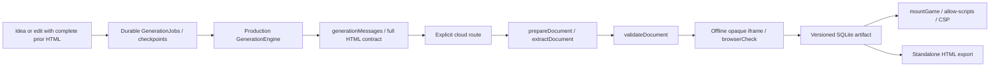

# MICRO-026 — Architecture audit and offline constructor experiment

## Audit completed before implementation (2026-10-16)

Baseline: main `37653b984e41f7486f218e055673857222b96ecb`, ff-only pull already
up to date. MICRO-025 is absent. Only untracked `docs/Keys_Bilayn.pdf` existed.
Actions REST: `enabled:false`, 79 runs, latest 38877566527. No inference allowed.



Source inspection: `src/generation.ts`, `live.ts`, `jobs.ts`, `transport.ts`,
`contracts.ts`, `validation.ts`, `browser-check.ts`, `full-html-check.ts`,
`runtime.ts`, `api.ts`, `store.ts`, `ui.ts`, `src/orchestrator/*`, existing
engine/orchestrator/browser tests and TASK-013/016/017 reports.

### What is generated again

Production asks the model to implement loop, rendering, keyboard, touch,
collision, timer, score/health, start/win/loss/restart, pause and game rules in
every response. Saving versions and session events belong to the host; arbitrary
in-game state persistence is not a universal production feature. GameSpec is
request metadata (prompt/audience/genre/mechanics/controls), not an executable
game definition. Editing receives the complete prior HTML and original idea.
The production contract does not require the experimental runtime or telemetry.

CloudTransport defaults to 12000 output tokens (validated range 256–32000), input
envelope cap 300000 bytes and wire cap 1210000 bytes; HTML cap is 200000 bytes.
These caps cover different objects and must not be confused with truncation.

### Existing reusable substrate and limits

The Orchestrator has canvas sizing, capped RAF loop, keyboard/pointer pad, grid,
AABB/circle collision/motion, FSM, score and session bridge. Its HTML builder
provides menu/pause/results/restart and visibility pause. The heuristic selector
selects technical helpers, not complete mechanics; unfamiliar space falls back
to full HTML. Model-written code still owns initialization, timers, board rules,
collision effects, progression and objectives. It rejects edits. It is isolated
from production. Input listeners lack a dispose API and pointer capture; its
canvas/pad placement is not a universal short-viewport layout guarantee.

Duplicate responsibilities are visible in the full-HTML prompt, Orchestrator
system prompt, primitive sources and authored demo/game fixtures. Reusable:
collision/grid/score primitives, structural validation, offline browser checker,
CSP/sandbox, lifecycle/input/scene infrastructure. Keep jobs, cancellation,
checkpoints, idempotency, routes, storage/version history, authorization and
exports unchanged. Future replacement candidate is only artifact construction,
after independent LIVE and edit evidence; no production replacement in this task.

### Failure classes (do not collapse into one cause)

* Format: extractDocument requires an entire document; incomplete/wrapped output
  can produce LLM_INVALID_HTML. prepareDocument only repairs confirmed JSON-string
  documents or a missing doctype; no genre-specific source rewriting.
* Generated semantics: MICRO-021's null HUD selector interrupted match-three
  gravity/refill; TASK-017 recorded Tetris dt seconds compared with 800 and Drop
  writing an unused field. These are artifact defects, not provider failures.
* Mobile: MICRO-023L's ontouchstart-only gate hid controls in one environment;
  MICRO-024 observed different served-iframe behavior without changing that HTML.
* Verification: BROWSER_CHECK_INCONCLUSIVE / timeouts mean missing evidence.
  The full-HTML gate proves startup and reports deeper gameplay NOT_VERIFIED.
  TASK-017 requires actions, progress, threshold, terminal UI and restart, beyond
  game_won. Existing adapters cover bounded numeric goals, not arbitrary genres.
* Transport: connection interruption, SSE framing/body caps and service GET
  availability are separate from model output quality; no network cause inferred.

### Options and engine decision (before implementation)

| Option | Model responsibility | Benefit | Remaining uncertainty |
| --- | --- | --- | --- |
| A Full HTML (production) | Entire artifact | Broadest freedom, current edits | Repeated technical logic and semantic defects |
| B Strict shell (existing Orchestrator) | Almost all gameplay JS | Reuses small technical substrate | Rules/timing still generated; no edits |
| C Blueprint + components + original JS | Structure and novel rules | Deterministic shared mechanics and bounded schema | LLM compliance/originality/latency untested |

Phaser 4 investigated using official documentation and source, not Phaser AE.
[Package v4.2.1](https://github.com/phaserjs/phaser/blob/v4.2.1/package.json)
exports ESM/UMD and TypeScript declarations; its
[MIT license](https://github.com/phaserjs/phaser/blob/v4.2.1/LICENSE.md) permits
redistribution with copyright/license notice. Scenes, keyboard/pointer input,
Arcade/Matter physics and Canvas/WebGL are available. The
[v4 migration guide](https://github.com/phaserjs/phaser/blob/v4.2.1/changelog/v4/4.0/MIGRATION-GUIDE.md)
marks Canvas deprecated, retaining it with reduced features. Mobile browser
support is documented; particular WebViews and physical devices need testing.

Inline bundling of the distribution and data assets can in principle produce
one offline HTML under script unsafe-inline without eval or remote loaders.
The loader must avoid external requests and optional plugins/workers. Actual
Phaser CSP/WebView/startup/build compatibility was not executed here. Official
bundle size is measured separately; startup/build comparisons are NOT_TESTED.

Decision: extend the existing authored substrate in an isolated research module,
reusing grid/physics/score source. Do not install Phaser or alter Orchestrator.
The small grid-world/board/scrolling experiment does not require full scene,
texture or physics infrastructure. This is a minimum-scope choice, not a measured
claim that this engine is faster or more reliable than Phaser or full HTML.

Visual Kit: no Neon Arcade / Pixel Retro implementation found among tracked
source/assets at the audit baseline. Use two explicitly authored test palettes
and a tiny embedded SVG, without claiming integration or AI-generated graphics.

## Blueprint and compiler contract

Research source: `src/research/constructor/{blueprint,compiler,runtime,fixtures}.ts`.
No production module imports this research code: only the unit test and explicit
research runner invoke compilation. The PoC consumes existing
validator/CSP, event bridge and grid/physics/score sources without editing them.

`GameBlueprint.version=1` has a descriptive family, one active `play` scene,
4–12-cell world dimensions, walls, player/health, up to 80 entities, a component
list, score/collected/elapsed goal, time/move limits, optional board, test theme
and a browser-only JS module. Ready/play/pause/result are core lifecycle states.
This is intentionally not a general scene graph or game platform. Health zero
loses first; reaching the goal wins before time/move exhaustion, so the last
allowed move can win. All state is per run; restart resets it in place.

The exported Draft 2020-12 JSON Schema uses a small documented vocabulary:
type/const/enum, numeric/string/array bounds, pattern, uniqueItems, required,
properties and additionalProperties:false. A dependency-free evaluator executes
exactly this schema, without coercion or external refs. Semantic checks reject
missing/mixed board components, chase+scroll, incompatible entities, duplicate
IDs, off-map/wall spawns, invalid board colors/length and conflicting deadlines
or impossible fixed collected counts. It does not prove every map solvable.

Compiler flow: size/schema → compatibility → parse JS with esbuild (no Node
execution) → select shared source components → safely encode Blueprint →
inline shell/CSS/data-SVG/runtime/module → parse assembled JS → existing static
validator. The runner explicitly passes HTML to the unchanged browser checker.
The compiler is synchronous; browser validation is a separate measured step.
Earlier exported HTML remains independent when a revised Blueprint is compiled.
No storage or editor integration, migrations, route changes or feature flags.

| Layer | Responsibilities |
| --- | --- |
| Core | Capped single RAF, hidden-page pause, keyboard/pointer controls, scene states, reset, bounded snapshots, data asset, Canvas rendering |
| Shared components | Grid movement/walls, item collection, timed pursuit, scrolling entities, swap/match/gravity/refill, score/damage/goal effects |
| Original module | Event-dependent rules, spawned entities, behavior changes, goal changes, small visual effects |

### Generated Logic API and boundaries

The module is a separate ordinary inline script calling an installer with a
frozen API. It is parsed as an arrow-function body, never eval/Function on Node.
The installer global is removed after use. API:

* `on(start|step|collect|match|collision|tick, handler)` (maximum 32 listeners);
* `state()` / `entity(id)` return detached snapshots, never engine objects;
* `score(delta)`, `damage(amount)` validate finite bounded values;
* `spawn(entity)` validates type, behavior, bounds, ID uniqueness and entity cap;
* `goal(metric, threshold)`, `behavior(id, value)`, `animate(id)`.

The schema caps the module at 8000 characters and JSON at 24000 UTF-8 bytes;
compiled HTML must pass the existing 200000-byte cap. Inline closing tags and
known forbidden execution are rejected. Source regexes are defense in depth,
not a JS capability security proof. Arbitrary browser JS still has browser
globals and can hang its iframe; the API is a cooperative contract. The existing
bounded browser validator is necessary for hostile or broken code.

The actual execution boundary is the existing opaque `sandbox="allow-scripts"`
iframe, with GAME_CSP before game content and again in the exported HTML.
No same-origin permission, Node/SQLite/backend objects, credentials or secret
environment are passed. CSP denies networking, eval, workers, frames and forms.
Positive gameplay has zero runtime errors; a separate ordinary inline security
probe confirms parent DOM/storage denial, network/eval denial and absent Node
globals. DevTools evaluate is used only to read the probe result: executing eval
through DevTools itself would not be a faithful CSP test. Event forwarding uses
unchanged mountGame session/source/origin validation; it is not a game proof.
Browser launch uses the OS sandbox and an environment allowlist without keys.

## Games, variation and visual scope

All fixtures and JS modules are authored locally, labelled offline research,
not responses from a model. There are no title/family-based template branches:
component registrations define behavior. House and race share movement,
collision, collection, state, rendering and input; board uses shared grid,
score/input/lifecycle plus a generic match-three component.

| Scenario | Real actions and independent outcome checks | Desktop / touch |
| --- | --- | --- |
| Чистый дом | Traverse two rooms/doorway; collect both objects; score 7 with module bonus; empty item set; visible win. Contact pursuing enemy → HP 0/loss; restart clears score/world | VERIFIED / VERIFIED |
| Три в ряд | Adjacent swap → 3-match, removal/gravity/refill, score ≥30, 16 nonempty cells, win. Three invalid swaps → zero score/move-limit loss; restart resets board | VERIFIED / VERIFIED |
| Автогонки в джунглях | Steer to bonus lane; scrolling obstacles advance ≥6 times; collect bonus/score10; survive 4s to win. Stay in obstacle lane → collision/HP0/loss; restart | VERIFIED / VERIFIED |
| House variant | Collect key → spawn new token, awaken pursuer, change score goal; four actual collections reach score6/win | Win VERIFIED; separate loss/restart NOT_VERIFIED |

Parameters: world geometry, entity count, colors, initial positions, thresholds.
Composition: house chase and race scrolling share collect/move; board swaps
are a distinct reusable mechanism. Original executable rule: the key handler
creates an object, changes enemy behavior and changes the goal after an event.
It is not a color/name/number substitution. The module's source and a separate
variant are in fixtures.ts; new conforming JS can be supplied without modifying
the compiler. This demonstrates the contract, not cloud model competence.

Scope limits: lane/grid steering, geometric sprites and one play scene; no
vehicle dynamics, track campaign, pathfinding around rooms or rich graphics.
Pursuers can be obstructed; fixed maps are tested, arbitrary maps are not proven.
Match cascades are bounded at 8 and fail explicitly if unresolved. Seeded refill
does not guarantee every future board has a move. No claim of genre completeness.

Two test themes change the same House gameplay, including independent desktop
and touch replay. A tiny authored SVG is embedded as data; no CDN or Visual Kit
files changed. Neon Arcade / Pixel Retro integration and AI graphics NOT_TESTED.
Responsive checks cover 320/360/390/430px, 768px tablet, landscape rotation and a
390×320 short viewport. Touch buttons ≥44px remain reachable, Canvas survives
rotation, no horizontal overflow. Safe-area CSS is present; physical Android,
iOS/WebViews and Telegram, and a real software keyboard, are NOT_TESTED.

## Measurements and fair comparison

Historical Full HTML baseline is independently recorded in SESSION_HANDOFF:
MICRO-023L, gemma4:31b, 4546 output tokens, request13149ms, validation1546ms,
job14699ms. One specific run, not an average or a constructor speed comparison.

Current offline measurements (seven fresh browser contexts **per game**):
Chromium 156.0.8078.4, 390×844 DPR2, CPU×4; network RTT150ms,
1.6Mbps down/750kbps up, cache disabled, warm loopback static server. No
production shell, API or LLM is measured. Node compilation is unthrottled.
Interactive = navigation to visible Start + actual touch Start and observed
playing state; rendering = two RAF callbacks, not a frame-rate guarantee.

| Game | Blueprint bytes (includes logic) | Logic bytes | Runtime bytes | HTML / gzip bytes | Compile p75 ms | Load p75 ms | Start p75 ms | Interactive p75 ms | Render p75 ms |
| --- | ---: | ---: | ---: | ---: | ---: | ---: | ---: | ---: | ---: |
| House | 644 | 67 | 12112 | 15775 / 6188 | 3.83 | 326.88 | 65.03 | 385.89 | 26.80 |
| Match-three | 416 | 55 | 12825 | 16262 / 6401 | 3.67 | 328.74 | 66.08 | 395.58 | 31.40 |
| Race | 711 | 88 | 12016 | 15774 / 6221 | 3.75 | 325.78 | 62.93 | 390.13 | 22.00 |

First process compile (House) was 45.03ms, including esbuild service startup;
warmed per-game p75 above must not be described as a cold compiler result.
Existing browserCheck wall times: House3012.02ms, Match2803.02ms, Race2875.84ms.
All passed technical startup/input/pause gates; those receipts alone do not
prove win/loss. Separate real-action gameplay checks above do.

[Official Phaser v4.2.1 minified distribution](https://github.com/phaserjs/phaser/blob/v4.2.1/dist/phaser.min.js)
is 1375976 bytes according to GitHub contents metadata (blob
8d3fda95e9bb975c523747a688a7abb99115c662). This full prebuilt distribution alone
exceeds the current HTML cap; a custom build would require separate measurement.
Raw-host download failed; Phaser gzip/build/load performance is NOT_MEASURED,
and Phaser was neither installed nor executed. Size metadata is not a local
performance benchmark. The custom runtime is adequate for this bounded scope.

No measured model tokens, inference time, E2E speedup, reliability rate or quality
advantage is claimed for C. Local JSON/source bytes are not model output tokens.
The central hypothesis remains UNPROVEN pending authorized equal-prompt LIVE
A/B/C generation, repeated failures/latencies, edit and originality acceptance.

## Reproduce and verification boundaries

After ordinary project setup (`npm ci` and `npm run checker:install`), run:

```sh
npm run typecheck
npm run build
node --test tests/constructor.test.ts
node scripts/constructor-proof.ts
# Short replay without the 21 performance runs:
node scripts/constructor-proof.ts --quick
```

No .env loading, production server or DB is needed by the research runner. It
binds an ephemeral loopback-only read-only static server, generates exports and
machine-readable schema in `.local/micro026/`, then closes server/browser.
Open house.html, match3.html or race.html directly to play offline. The runner
records per-action snapshots, terminal screenshots, event order, measurements,
browser-check diagnostics and security probes in receipt.json. Browser keyboard,
mouse/touch actions drive gameplay; no score/time/state injection or force-win.

Local typecheck/build PASS; Node units 235/235 (5 constructor tests), Python
19/19 and CI policy 8/8. Separate existing runtime/export/CSP Playwright smoke
8/8. Research runner has 10 desktop/touch gameplay sessions (including two themes
and variant), 18 layout/rotation cases, standalone export checks, security probe,
12×12 board regression (score2197 after 144-cell match/cascades), three existing
browser checks and 21 timing runs. No heavy browser matrix required. Independent
review found and resolved the internal score-cap mismatch and an ambiguous
network probe; CSP proof now requires connect-src violation and zero requests
received by a controlled reachable loopback endpoint. Module score remains
bounded to 1000 per call while trusted component scoring supports larger boards.
One parallel unit replay timed out an existing tunnel backend startup; isolated
serial replay passed235/235 without changing timeouts or production code.

Expanded legacy production.spec selection: 9 PASS, 8 intentional profile SKIP,
7 FAIL. HTTP-disconnect fixture uses CLOUD_BASE_URL=localhost and now fails
FREE_MODEL_REQUIRED; old local Ollama fixtures are unconfigured under current
MICRO-019/023 routes. The first failure was reproduced from an exact git archive
of baseline main in `.local/micro026/baseline-main/`. All production/test fixture
sources are byte-identical to main; research files are not imported there.
These are pre-existing coverage gaps, not fixed by weakening production routes.
FULL suite/Ubuntu/physical-device/release acceptance is not claimed.

Protected inventory: 345 existing files hashed, 344 unchanged including .env,
PDF and user databases; the only changed file is the existing synthetic Telegram
consumer SQLite for tests/tunnel.test.ts's synthetic token. It is the isolated
test ledger derived by src/telegram-bot.ts, not a user game DB; no restoration
or deletion was performed. Production source diff is empty. No user game,
version, job/checkpoint or Visual Kit was edited. Secret scans cover history and
the explicit publication manifest; no findings. Private evidence remains ignored.

Actions remain disabled; baseline79 runs, latest38877566527. No workflow edits,
dispatches or Actions enable. Hosted checks are unavailable, never green here.
Risk-selected normal policy remains FULL; MICRO-019 permits the local substitute
and this task explicitly excludes a heavy matrix. This is not a release.

## Verdict and next decision

Audit PASS. PoC PASS **within the documented offline grid/board/scroll scope**.
Overall ITERATE: proceed to a separately budgeted LIVE comparison before any
production adoption. Production UNCHANGED, MVP scope unchanged, LIVE NOT_TESTED,
0 new real inference POST. Do not describe authored fixtures as Beeline-case
LLM-generation acceptance; the actual model must create original code/structure.

Potential future transfers: schema validation, deterministic components,
visibility/disposal handling, bounded module contract, separate per-aspect
gameplay evidence. Experimental only: constructor compiler/fixtures/runtime,
single-scene model and generic adapters. Next gates: fix legacy test harness in
a separate scoped change; equal-prompt real model A/B/C, preserved-source edits,
novel modules beyond this library, and physical mobile/WebView acceptance.
Git commit/PR/merge receipt is reported with the completed delivery.

## MICRO-027 LIVE follow-up — 2026-10-17

One paired idea was sent to gemma4:31b. Full HTML2770 output tokens/9894 bytes
was delivered through production UI after checkpoint revalidation and independently
played on desktop/touch via decoded QR. Initial separate Full HTML attempt had
connect timeout. Blueprint884 tokens/2814ms returned HTTP200, passed JSON shape
but failed semantic compatibility: move/collect topdown included a board with125
cells for a5x5 world. No compiler, constructor runtime or production adoption was
changed. Compile/check/gameplay times for that rejected Blueprint are unavailable,
not zero. Full-source real edit was not exercised; the four-POST task budget is
exhausted. Decision remains ITERATE; no statistical advantage is established.
See [MICRO-027 report](micro-027-report.md) for proof and remaining mobile limits.
